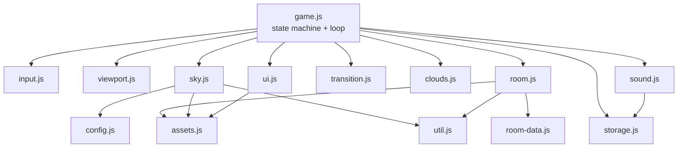
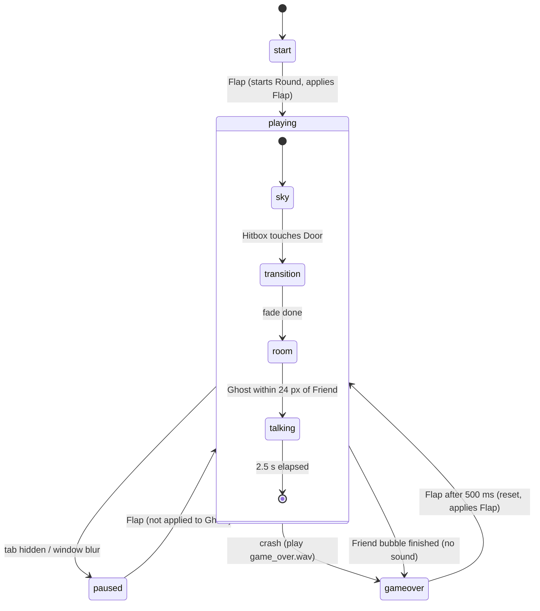

# Design Document

## Overview

Flappy Kiro is a single-page, canvas-based game written in plain JavaScript. It has no build step and no server component, so it must work when `index.html` is opened directly from disk (Requirement 1.1). That constraint drives several choices below (classic scripts instead of ES modules, `HTMLAudioElement` instead of Web Audio, and pre-measured sprite bounds instead of reading pixels at run time).

A Round has three stages:

1. **Sky_Scene**: the side-scrolling flight. Score 5 stops the pipes and brings in a door.
2. **Door_Transition**: fade to black, switch scene, fade in.
3. **Room_Scene**: the top-down room, where the player walks to the Friend_Ghost, who says "Nice job!".

The game is a state machine (`start`, `playing`, `paused`, `gameover`). The `playing` mode has the three stages inside it. One loop updates the active state with a clamped time step and draws everything to a single canvas at a fixed 1280 × 720 logical resolution.

All numbers are in logical pixels (px) unless stated otherwise. The values come from the requirements and are kept in one `config.js`.

### Design decisions

| Decision | Choice | Why | Alternative rejected |
|---|---|---|---|
| Rendering | One 2D canvas at 1280 × 720 logical size, scaled by CSS and a canvas transform | Meets Req 1.2, 1.4, 1.5, 1.7. One coordinate space for all logic. | DOM elements per sprite: harder to scale and layer |
| Code layout | Several classic `<script>` files sharing a global `FK` namespace | `<script type="module">` is blocked from `file://` in Chrome, which would break Req 1.1 | ES modules (need a server) |
| Time step | Variable step from real elapsed time, clamped to 1/30 s, with exact constant-acceleration integration | Meets Req 10.1 and 10.2 with simple code. Exact integration keeps jump height nearly independent of frame rate. | Fixed-step accumulator: more code, no benefit here |
| Sprite bounds | Opaque bounding boxes measured once, offline, stored in `config.js` | `getImageData` on an image from `file://` throws a security error in Chrome | Measuring at run time |
| Audio | `HTMLAudioElement` | Web Audio needs `fetch` or XHR to decode files, which fails on `file://` | Web Audio API |
| Room collision | Axis-aligned rectangles authored in room-image coordinates | Furniture is rectangular in the reference picture, and rectangles make sliding trivial | Per-pixel collision mask: needs pixel reads |
| Asset loading | Never block start-up. Every drawer has a fallback when its image is missing. | Meets Req 10.7, 10.8, 14.13 | A loading screen that waits for every file |

## Architecture

### File layout

The starter kit's `index.html`, `style.css` and `game.js` predate the spec and will be replaced.

```
kiro-introduction-starter-kit/
├── index.html            canvas + script tags in dependency order
├── style.css             full-window layout, centered canvas
├── assets/               ghosty.png, jump.wav, game_over.wav, plus
│                         door.png, room.png, shadow.png,
│                         ghost-front.png, ghost-back.png,
│                         ghost-left.png, ghost-right.png
└── js/
    ├── config.js         all constants and sprite bounds
    ├── util.js           clamp, rect overlap, rect distance, random
    ├── storage.js        safe localStorage wrapper
    ├── assets.js         image loading with fallbacks, tinted copies
    ├── sound.js          jump / game over sounds, mute
    ├── input.js          keyboard, pointer, touch, mute hit-testing
    ├── viewport.js       scaling, device pixel ratio, coordinate mapping
    ├── clouds.js         cloud field
    ├── sky.js            sky ghost, pipes, door, scoring, victory
    ├── room-data.js      room rectangles, start and friend positions
    ├── room.js           room ghosts, walking, idle animation, bubble
    ├── transition.js     fade timeline
    ├── ui.js             status bar, mute button, screens, overlays
    └── game.js           state machine and main loop
```

### Module relationships



Logic modules (`sky.js`, `room.js`, `clouds.js`, `transition.js`, `util.js`) hold their state in plain objects and expose `update(state, dt, input)` and `draw(ctx, state)` functions. Their `update` functions never touch the DOM, so they can be exercised from Node by adding a `module.exports` guard at the bottom of each file.

### State machine



`game.js` holds this state:

```js
const game = {
  mode: 'start',            // 'start' | 'playing' | 'paused' | 'gameover'
  resumeMode: null,         // mode to return to after a pause
  stage: 'sky',             // 'sky' | 'transition' | 'room'   (valid while playing)
  gameOverAt: 0,            // timestamp used for the 500 ms input lock
  score: 0,
  high: 0,
  newHigh: false,           // true if this Round raised the High_Score
  muted: false,
};
```

### Main loop

```js
function frame(now) {
  const dt = Math.min((now - last) / 1000, 1 / 30);   // Req 10.1, 10.2
  last = now;
  update(dt);
  draw();
  requestAnimationFrame(frame);
}
```

- `update(dt)` always updates the clouds (Req 3.6), then updates the active mode and stage.
- While `paused`, `gameover`, or `start`, the ghosts, pipes, and timers are not advanced, except where noted in the requirements (the start-screen hover and the cloud drift).
- When the tab becomes visible again after a pause, `last` is reset to the current timestamp so that the first frame has a normal `dt`.
- `draw()` clears the canvas, draws the scene for the current stage, then the status bar, then any overlay.

## Components and interfaces

### config.js

One frozen object holding every number from the requirements, so nothing is hard-coded elsewhere.

```js
FK.C = Object.freeze({
  W: 1280, H: 720, BAR_H: 60, FIELD_H: 660,

  // Sky ghost
  GHOST_X: 320, GHOST_H: 48,
  FLAP_V: 420, GRAVITY: 1500, MAX_FALL: 600, MAX_TILT_DEG: 25,

  // Pipes and door
  PIPE_SPEED: 240, PIPE_BODY_W: 80, CAP_EXTRA: 12, CAP_H: 30,
  PIPE_SPACING: 360, GAP_H: 240, GAP_MARGIN: 60, GAP_STEP_MAX: 200,
  FIRST_PIPE_X: 1480,
  VICTORY_SCORE: 5,
  DOOR_W: 185, DOOR_H: 330, DOOR_SPACING: 360,

  // Hitbox
  HITBOX_INSET: 0.12,

  // Clouds
  CLOUD_MIN: 5, CLOUD_MAX: 8, CLOUD_SPEED: [20, 100], CLOUD_ALPHA: [0.4, 0.8],

  // Screens and transition
  GAMEOVER_LOCK: 0.5,
  FADE_OUT: 1.0, FADE_HOLD: 0.5, FADE_IN: 1.0,

  // Room
  ROOM_GHOST_H: 64, ROOM_SPEED: 220, TOUCH_STOP_DIST: 8,
  FRIEND_TRIGGER_DIST: 24, BUBBLE_TIME: 2.5,
  BOB_AMPLITUDE: 4, BOB_PERIOD: 1.6, BOB_EASE: 0.15,
  HOVER: 6,                                  // sprite floats above Ground_Position
  SHADOW_W: 44, SHADOW_H: 8, SHADOW_ALPHA: 0.35, SHADOW_Y: -4,
  FRIEND_TINT: 'rgba(120,180,255,0.45)',
});
```

Sprite bounds are stored as fractions of each image, measured once from the real files during implementation (for example with a short Python or Node script):

```js
FK.SPRITE_BOUNDS = {            // opaque bounding box, 0..1 of image width / height
  'ghosty.png':      { l: 0, t: 0, r: 1, b: 1 },
  'ghost-front.png': { l: 0, t: 0, r: 1, b: 1 },
  // ...measured values replace these placeholders
};
```

### storage.js

```js
FK.Storage = {
  loadHigh(): number,          // validated; 0 on any problem (Req 8.5, 8.6)
  saveHigh(n): void,           // try/catch; failure is silent (Req 8.7)
  loadMuted(): boolean,        // false on any problem (Req 9.6)
  saveMuted(b): void,
};
```

- Keys are `flappyKiro.high` and `flappyKiro.muted`.
- A stored high score is accepted only if it matches `/^\d+$/` and `Number.isSafeInteger` is true.
- If `localStorage` throws, a module-level variable keeps the value for the session.

### assets.js

```js
FK.Assets = {
  image(name): HTMLImageElement | null,   // null until loaded, or if it failed
  tinted(name, color): HTMLCanvasElement | null,   // cached tinted copy (friend ghost)
};
```

- All images are requested at start-up. Nothing waits for them.
- `image()` returns `null` unless `complete && naturalWidth > 0`, so every drawer handles the missing case with its fallback.
- `tinted()` draws the image onto an offscreen canvas and fills the color with `globalCompositeOperation = 'source-atop'`. This only draws, it never reads pixels back, so it works on `file://`.
- Fallbacks (Req 10.7, 10.8, 14.13): a white rounded shape for ghosts, a brown rectangle for the door, a wood-colored rectangle for the room, and a dark oval for the shadow. The room's ghost sprites fall back to `ghosty.png` first.

### sound.js

```js
FK.Sound = {
  playJump(): void,      // restarts the clip from 0 (Req 9.2)
  playGameOver(): void,
  setMuted(b): void,     // stops all playing sounds when muting (Req 9.5)
  isMuted(): boolean,
};
```

- Each clip is one `Audio` element. Playing sets `currentTime = 0` and calls `play()`.
- Every `play()` call is wrapped in try/catch and `.catch(() => {})` so blocked or missing audio never shows an error (Req 9.7).
- When muted, the play functions return immediately.

### viewport.js

```js
FK.Viewport = {
  resize(): void,                       // called on load and on window resize (Req 1.6)
  toLogical(clientX, clientY): {x, y},  // for pointer input
};
```

Algorithm for `resize()`:

1. `s = Math.min(innerWidth / 1280, innerHeight / 720)`
2. Set the canvas CSS size to `1280·s × 720·s`. The page CSS centers it with flexbox.
3. Set the backing store to `cssWidth · dpr × cssHeight · dpr`, where `dpr = devicePixelRatio`.
4. Set the context transform to `scale = cssWidth · dpr / 1280`, so all drawing code stays in logical px.
5. `toLogical` uses `getBoundingClientRect()`: `x = (clientX − rect.left) / rect.width · 1280`.

Resizing changes only the transform. No game state is touched, so the Round continues (Req 1.6).

### input.js

Input is polled once per frame, so game code does not depend on event timing.

```js
FK.Input = {
  consumeFlap(): boolean,         // true once per new press (Space, Up Arrow, click, tap)
  consumeMuteToggle(): boolean,   // M key, or pointer press on the mute button
  moveVector(): {x, y},           // arrow keys, or touch-hold direction (room only)
  pointerTarget(): {x, y} | null, // logical point being held (room only)
  clear(): void,                  // on blur, drops held keys and the pointer
};
```

- **Keyboard:** `keydown` ignores events with `e.repeat`, which gives one Flap per press (Req 5.2). `Space` and the arrow keys call `preventDefault()` so the page never scrolls. A `Set` of held arrow codes feeds `moveVector()`.
- **Pointer:** `pointerdown` on the canvas converts the point to logical coordinates and tests it against the mute button rectangle first. A hit sets the mute-toggle flag and does not set the flap flag (Req 9.4). Otherwise it sets the flap flag and records the held point. `pointerup`, `pointercancel` and `pointerleave` release it. The canvas has `touch-action: none`.
- **Room movement vector:** `moveVector()` returns the arrow-key vector `(right − left, down − up)`. Opposite keys cancel (Req 12.6). If both components are non-zero, the vector is multiplied by `1/√2`. When no key is held and a pointer is held, `room.js` builds the direction toward `pointerTarget()` itself and stops within 8 px (Req 12.9).

### clouds.js

```js
cloud = { x, y, w, h, speed, alpha }
FK.Clouds = { create(): Cloud[], update(clouds, dt): void, draw(ctx, clouds): void };
```

- `create()` makes 6 clouds. For each, a random size factor `k` in `[0, 1]` sets `w = 70 + 70k`, `h = 0.5·w`, and `speed = 20 + 80k` (so larger is faster, Req 3.3). Opacity is random in `[0.4, 0.8]`.
- The maximum cloud speed of 100 px/s is below the pipe speed of 240 px/s (Req 3.4).
- When `x + w < 0`, the cloud is placed at `x = 1280` with a new random `y` inside the Playfield (Req 3.5).
- Clouds are updated on every screen, including `paused` while the tab is visible (Req 3.6, 10.5). They are not drawn in the Room_Scene (Req 12.11).

### sky.js

The sky ghost, pipes, door, collisions, scoring, and the victory trigger.

```js
sky = {
  ghost: { x, y, vy },
  pipes: [ { x, gapY, scored } ],       // x = leading edge (left edge of the cap)
  door:  null | { x },
  score: 0,
  victory: false,                       // true after the Victory_Score is reached
};

FK.Sky = {
  create(): sky,
  update(sky, dt, flap): 'ok' | 'crash' | 'door',
  draw(ctx, sky, t): void,
};
```

#### Ghost physics (Req 5)

On each update, with the current `dt`:

```js
// exact integration of constant acceleration over dt
g.y  += g.vy * dt + 0.5 * GRAVITY * dt * dt;
g.vy  = Math.min(g.vy + GRAVITY * dt, MAX_FALL);
```

A Flap sets `g.vy = -FLAP_V` before this step, replacing the old velocity (Req 5.3). The rise from one flap is `420² / (2 · 1500) = 58.8 px`.

The sprite is tilted by `angle = vy < 0 ? −25° · (−vy / 420) : 25° · (vy / 600)`, which stays within ±25° in both directions (Req 5.6).

#### Sprite size, Ghost_Bounds and Hitbox

```
drawn height = 48, drawn width = 48 · (naturalWidth / naturalHeight)
Ghost_Bounds = drawn rect scaled by SPRITE_BOUNDS['ghosty.png']
Hitbox       = Ghost_Bounds inset by 12% of its width (left, right) and 12% of its height (top, bottom)
```

The aspect ratio comes from `ghosty.png` (1290 × 1567), so it is known before the image loads. The Hitbox is 76% of the Ghost_Bounds in each dimension and is never rotated. The tilt is visual only.

#### Pipes (Req 6)

Pipe geometry, with `x` as the leading edge:

```
cap:  x ... x + 92, 30 px tall at the gap edge
body: x + 6 ... x + 86 (80 px wide)
top pipe:    body 0 .. gapTop − 30,   cap gapTop − 30 .. gapTop      (gapTop = gapY − 120)
bottom pipe: cap gapBottom .. gapBottom + 30,   body gapBottom + 30 .. 660   (gapBottom = gapY + 120)
trailing edge = x + 92
```

Each Pipe_Pair is tested as four rectangles (two bodies, two caps), so the narrower body is not treated as the cap width.

Generation:

```js
function nextGapY(prev) {
  const lo = Math.max(60 + 120, prev - 200);        // GAP_MARGIN + half gap
  const hi = Math.min(660 - 60 - 120, prev + 200);
  return lo + Math.random() * (hi - lo);            // uniform
}
```

- The gap center is always inside `[180, 480]`, so the gap is at least 60 px from the top and bottom of the Playfield (Req 6.5).
- The center differs from the previous one by at most 200 px, which is reachable at the pipe spacing (Req 6.6). A pipe pair arrives every 1.5 s, and a sustained flapping climb is about 215 px/s.
- The first pipe is placed at `x = 1480` with a random center in `[180, 480]`. Each following pipe is placed at `last.x + 360`.
- Each update: every pipe moves left by `240 · dt`. Pipes with `x + 92 < 0` are removed. `while (spawning && last.x < 1280) push(next at last.x + 360)`, where `spawning` is `score < 5`. That keeps at least one pair beyond the right edge (Req 6.8).

#### Collision and crash (Req 7)

Each update, after movement:

1. If `hitbox.top <= 0` or `hitbox.bottom >= 660`, the result is `'crash'`.
2. If the Hitbox overlaps any of the four rectangles of any pipe, the result is `'crash'`.
3. If a door exists and the Hitbox overlaps the door rectangle, the result is `'door'`. The crash checks run first, so a pipe or the floor still wins if both happen in the same step.

Tunneling is not possible with the clamped step. A pipe moves at most `240/30 = 8 px` per step and the Ghost at most `600/30 = 20 px`. Both are smaller than the thinnest obstacle (the 30 px cap and the 36 px Hitbox).

#### Scoring and victory (Req 8, 11)

```js
for (const p of pipes) {
  if (!p.scored && !sky.victory && ghostBounds.left > p.x + 92) {
    p.scored = true;
    sky.score += 1;
    // live high score (Req 8.3, 8.4)
    if (sky.score > high) { high = sky.score; game.newHigh = true; Storage.saveHigh(high); }
    if (sky.score === VICTORY_SCORE) startVictory(sky);
  }
}
```

`startVictory`:

1. Set `sky.victory = true`. This stops scoring, so the Score never goes above 5 (Req 11.3), and stops spawning (Req 11.1).
2. Remove every pipe with `x >= 1280` (not yet visible). Visible pipes stay and stay solid (Req 11.2).
3. Create the door at `x = max(1280, lastTrailingEdge + 360)`, where `lastTrailingEdge` is `x + 92` of the last remaining pipe, or 0 if none remain (Req 11.4).

Door behavior (Req 11.5 to 11.7):

- Rectangle: `x`, `y = 330 − 165 = 165`, `185 × 330`.
- Each update: `door.x −= 240 · dt`. The door never stops, because the ghost keeps a fixed x and the door must come to it. If it leaves the left edge untouched, it is placed again at `x = 1280`, so the ghost can always reach a door.
- Drawn from `door.png`, or as a brown rectangle with a white frame if the image is missing.
- Gravity, Flaps, and the crash rules from the previous section stay active while the door is on screen.

### transition.js

A small timeline object that runs from the moment the Hitbox touches the door.

```js
transition = { t: 0, switched: false };

FK.Transition = {
  create(), 
  update(tr, dt): { alpha: number, switchNow: boolean, done: boolean },
};
```

| Time (s) | Phase | Overlay alpha |
|---|---|---|
| 0 to 1.0 | fade out | 0 → 1 |
| 1.0 to 1.5 | hold black | 1 |
| 1.5 to 2.5 | fade in | 1 → 0 |

- `switchNow` is true once, when `t` first reaches 1.0. At that moment `game.js` creates the room (`stage = 'room'`, with the room's state in place but controls locked), so the first fade-in frame already shows the Ghost at its start position (Req 12.3).
- The overlay is a black rectangle over the Playfield only (0, 0, 1280, 660). The status bar is drawn after it and is not faded (Req 11.10).
- `dt` is zero while paused, so the timeline pauses and resumes (Req 11.12).
- During the transition the sky objects are not updated, and Flaps are ignored (Req 11.9). Mute still works because it is handled before the stage logic.
- When `done`, `game.js` sets `room.controllable = true` (Req 11.11).

### room-data.js

All room layout data is in pixels of the cropped `assets/room.png` (718 × 483), and `room.js` converts it to Playfield pixels with the image's display scale, so it works at any window size. The values were measured on the real image with a 50 px grid. If `room.png` is replaced, they must be measured again.

```js
FK.RoomData = {
  floor:  { x, y, w, h },           // bounding rectangle of the walkable floor
  solids: [ { name, x, y, w, h } ], // bed, tables, chairs, bookshelf, dresser, ...
  start:  { x, y },                 // Ghost start, in the right third (x > 0.667)
  friend: { x, y },                 // Friend_Ghost position
};
```

Measured values, in pixels of the cropped room image (the file `js/room-data.js` is the source of truth; this table was the first estimate):

| Item | x | y | w | h |
|---|---|---|---|---|
| floor (inside the walls) | 18 | 162 | 699 | 321 |
| bookshelf | 19 | 87 | 94 | 120 |
| dresser | 122 | 132 | 87 | 78 |
| left bedside table | 240 | 145 | 49 | 60 |
| bed | 292 | 120 | 137 | 189 |
| right bedside table | 432 | 145 | 48 | 60 |
| desk | 2 | 326 | 56 | 144 |
| desk chair | 69 | 362 | 42 | 80 |
| round coffee table | 572 | 362 | 55 | 60 |
| armchair | 612 | 265 | 97 | 112 |
| **start** (Ghost) | 560 | 215 | | |
| **friend** | 360 | 350 | | |

- The rug and the sleeping cat are not in the list, so they are walkable (Req 12.2 and the note in the assumptions).
- The start point is in the right third, on clear floor above the armchair. The friend point is below the bed, about 330 logical px away, which satisfies the 200 px minimum, and a clear path joins the two.
- The bookshelf and bed extend above the floor line, which is fine because the walkable floor rectangle already excludes everything above `y = 162`, and the solids exclude the rest.

### room.js

```js
room = {
  rect: { x, y, w, h },            // where the room image is drawn inside the Playfield
  solids: [ rect ],                // solids in Playfield px
  floor: rect,
  player: RoomGhost,
  friend: RoomGhost,
  phase: 'walking' | 'talking',
  talkT: 0,
  t: 0,                            // animation clock
  controllable: false,
};

RoomGhost = {
  x, y,                 // center of the resting Ghost_Bounds, in Playfield px
  facing: 'front' | 'back' | 'left' | 'right',
  bob: 0,               // 0..1, how much of the idle animation is active
  tinted: false,
};

FK.Room = { create(), update(room, dt, input): 'ok' | 'done', draw(ctx, room): void };
```

#### Layout (Req 12.1)

At creation, the room image is scaled uniformly to the largest size that fits in the Playfield and centered, and everything is converted to Playfield px:

```js
const s = Math.min(1280 / img.w, 660 / img.h);   // uses the image's natural aspect ratio
rect = { w: img.w * s, h: img.h * s, x: (1280 - w) / 2, y: (660 - h) / 2 };
toPx = (nx, ny) => ({ x: rect.x + nx * rect.w, y: rect.y + ny * rect.h });
```

The rest of the Playfield is black. If the image is missing, a rectangle with a 3:2 aspect ratio is used in its place.

#### Ghost size and Hitbox

- Sprites are drawn 64 px tall, width from the aspect ratio of each sprite.
- The room Hitbox is computed once from the front sprite's Ghost_Bounds, with the same 12% inset, and is used for every facing. This keeps collisions the same when the Ghost turns.
- `Ground_Position` is the bottom center of the resting Ghost_Bounds.

#### Movement (Req 12.5 to 12.9)

```js
// each update while controllable and phase === 'walking'
const v = Input.moveVector();                    // already normalized for diagonals
const step = { x: v.x * 220 * dt, y: v.y * 220 * dt };

tryMove(player, step.x, 0);                      // x axis first
tryMove(player, 0, step.y);                      // then y axis
```

`tryMove` moves the Hitbox, then reverts that axis if the new Hitbox is not fully inside `floor`, overlaps any solid, or overlaps the Friend_Ghost's Hitbox. Testing the two axes separately gives sliding along walls and furniture (Req 12.7). The per-step distance is at most `220/30 ≈ 7.3 px`, smaller than any obstacle, so there is no tunneling.

Facing is set from the input vector, not from the actual displacement, so the Ghost turns even when it is blocked: horizontal input gives `left` or `right` (Req 12.8, diagonals use the horizontal sprite), otherwise vertical input gives `front` (down) or `back` (up). With no input, the facing is kept.

Pointer movement: if the vector comes from a held pointer and the Ghost's center is within 8 px of the target, the vector is zero and the Ghost stops.

No gravity, no Flaps, and no jump sound apply in the room (Req 12.10), because `Input.consumeFlap()` is not read during this stage.

#### Idle animation and shadow (Req 14)

```js
// per RoomGhost, every update (the friend is always idle)
const idle = ghost === room.friend || !movingNow;
ghost.bob = clamp(ghost.bob + (idle ? 1 : -1) * dt / 0.15, 0, 1);       // 0.15 s ease (Req 14.3)
const bobY = -Math.sin(2 * Math.PI * room.t / 1.6) * 4 * ghost.bob;    // ±4 px, 1.6 s (Req 14.1)
```

- `room.t` is one shared clock that only advances when `update` runs, so a pause freezes it and resuming continues from the same phase (Req 14.12).
- `movingNow` is true when `moveVector()` is not zero. A ghost stopped next to the friend is idle (Req 14.1).
- The sprite is drawn with its Ghost_Bounds bottom center at `(ground.x, ground.y − 6 + bobY)`. The `6` is the hover height, so the ghost floats above the floor.
- The **Shadow** is drawn centered at `(ground.x, ground.y − 4)`, 44 × 8 px at 35% opacity, and never uses `bobY` (Req 14.6 to 14.10). Because `ground` changes only with the ghost's real movement, the shadow follows a walking ghost and stays still while it bobs.
- The bob is a draw offset only. The Hitbox, collisions, and the 24 px trigger use the resting position (Req 14.5).

#### Friend ghost and ending (Req 13)

- The friend is placed at `RoomData.friend`, drawn with the tinted copies of the four sprites (Req 13.2).
- Its facing is chosen each update from the vector between the two ghosts: if `|dx| > |dy|` it faces left or right, otherwise front or back, toward the player (Req 13.3).
- Trigger: while `phase === 'walking'`, compute the edge-to-edge distance between the two Hitboxes:

  ```js
  const gx = Math.max(0, a.left - b.right, b.left - a.right);
  const gy = Math.max(0, a.top - b.bottom, b.top - a.bottom);
  if (Math.hypot(gx, gy) <= 24) { phase = 'talking'; talkT = 0; }
  ```

  After the trigger, movement input is ignored (Req 13.4). The bubble is shown once, because `phase` never returns to `walking` (Req 13.7).
- While `talking`, `talkT += dt`. At `talkT >= 2.5`, `update` returns `'done'` and `game.js` ends the Round without playing the crash sound (Req 13.8, 13.9).

#### Speech_Bubble (Req 13.5, 13.6, 14.11)

- Text: "Nice job!", bold 28 px monospace, dark color.
- Box: text width plus 24 px padding on each side, 56 px tall, white fill, 3 px dark outline, rounded corners.
- Position: centered on the friend's `ground.x`, with the box bottom 14 px above the top of the friend's resting Ghost_Bounds, plus a 10 px tail pointing down to the head. It does not use `bobY`.
- The box is clamped so that it stays fully inside the Playfield.

#### Room draw order (Req 14.6)

1. Black Playfield, then the room image.
2. Both shadows.
3. Both ghosts, sorted by `ground.y` so that the one lower on screen is drawn in front.
4. The speech bubble, when present.

### ui.js

```js
FK.UI = {
  drawStatusBar(ctx, score, high, muted): void,
  muteButtonRect: { x, y, w, h },            // also used by input.js for hit testing
  drawStart(ctx, t): void,
  drawGameOver(ctx, score, high, newHigh): void,
  drawPaused(ctx): void,
};
```

- **Status bar:** a dark rectangle at `y = 660`, 60 px tall. The text `Score: N | High: N` is white, bold 26 px monospace, centered at `x = 640` (Req 2.8). The mute button is a 48 × 48 px rounded square at the right end (`x = 1212`, `y = 666`), with a speaker icon drawn from paths and a slash when muted. 48 px is a comfortable touch target (Req 9.3).
- **Start screen:** the title "Flappy Kiro", the prompt "Press Space or tap to start", and the Ghost hovering at its start position with `y = 330 + sin(2π t / 1.2) · 8`. Pipes are not created, and gravity is not applied (Req 4.2, 4.3).
- **Game over screen:** a translucent dark band over the frozen scene with "Game Over", `Score: N   High: N`, "New High Score!" when `newHigh` is true, and "Press Space or tap to retry" (Req 4.6, 4.7). After a crash the band is centered in the Playfield. After the room ending it moves to the top, so the speech bubble stays visible (Req 13.8).
- **Paused screen:** a translucent overlay with "Paused" and "Press Space or tap to resume".

### game.js

The state machine and the loop. The per-frame order is:

```js
function update(dt) {
  Clouds.update(clouds, dt);                              // every mode (Req 3.6)
  if (Input.consumeMuteToggle()) toggleMute();            // before stage logic (Req 9.4)

  switch (game.mode) {
    case 'start':    updateStart(dt);    break;   // hover; Flap starts the Round
    case 'playing':  updatePlaying(dt);  break;
    case 'paused':   updatePaused();     break;   // Flap resumes, not applied
    case 'gameover': updateGameOver();   break;   // Flap retries after 500 ms
  }
}
```

`updatePlaying(dt)` branches on `game.stage`:

| Stage | Update |
|---|---|
| `sky` | `r = Sky.update(sky, dt, Input.consumeFlap())`. `'crash'` calls `endRound(true)`. `'door'` creates the transition and sets `stage = 'transition'`. |
| `transition` | `Transition.update`. At `switchNow`, create the room and set `stage = 'room'` while keeping the transition running. When `done`, set `room.controllable = true`. |
| `room` | `Room.update(room, dt, Input)`. `'done'` calls `endRound(false)`. |

The room stage starts while the transition is still fading in, so `updatePlaying` runs the transition and the room together until the transition is done. Flap input is discarded in these two stages (Req 11.9, 12.10).

`endRound(crashed)`:

1. Set `mode = 'gameover'` and record `gameOverAt`.
2. If `crashed`, call `Sound.playGameOver()`.
3. The scene stays frozen as it was and is drawn under the game over overlay (Req 4.7).

`startRound()` (from the start screen or a retry):

1. Create fresh sky state (ghost at `(320, 330)`, first pipe at `x = 1480`), zero the score, clear `newHigh`, discard the room and transition.
2. Set `mode = 'playing'`, `stage = 'sky'`, then apply the Flap that started it and play the jump sound (Req 4.4, 4.8, 9.1).

Pausing:

- `visibilitychange` (when hidden) and `window` `blur` call `pause()`. It does nothing unless `mode === 'playing'`. It stores `resumeMode = 'playing'`, sets `mode = 'paused'`, and calls `Input.clear()` (Req 10.4).
- On resume, the Flap is consumed without being applied, `last` is reset to the current timestamp, and `mode` returns to `playing` (Req 10.6).
- While paused, only the clouds update. The sky, room, idle animation, and transition do not, so they all resume exactly where they stopped (Req 10.5, 11.12, 14.12).

## Data models

```js
// Rect used everywhere: { x, y, w, h }, or { left, top, right, bottom } when derived

Sky ghost     { x: 320, y, vy }                              // y is the sprite center
Pipe          { x, gapY, scored }                            // x = leading edge
Door          { x }                                          // y fixed at 165
Cloud         { x, y, w, h, speed, alpha }
RoomGhost     { x, y, facing, bob, tinted }
Persisted     flappyKiro.high  (string of digits)
              flappyKiro.muted ('1' or '0')
```

## Error handling

| Failure | Behavior | Requirement |
|---|---|---|
| `localStorage` unavailable, throws, or holds a bad value | The high score starts at 0 and is kept in memory. Saves fail silently. Mute starts off. | 8.6, 8.7, 9.6 |
| Audio blocked by the browser or file missing | `play()` errors are swallowed. The game continues silently. | 9.7 |
| `ghosty.png` fails | A white rounded shape of the same size is drawn. Bounds fall back to the full rectangle. | 10.7 |
| A room ghost sprite fails | `ghosty.png` is drawn in its place. | 10.8 |
| `door.png`, `room.png`, or `shadow.png` fails | Brown rectangle, wood-colored rectangle, or dark oval of the same size. | 10.8, 14.13 |
| Very slow frame or a tab returning from the background | `dt` is clamped to 1/30 s and the loop timestamp is reset on resume. | 10.1, 10.2 |
| Window resized mid-Round | Only the scale transform changes. | 1.6 |
| Focus lost during a Round | The Round pauses and shows the paused screen. | 10.4 |
| Held keys left over after losing focus | `Input.clear()` drops held keys and the pointer on blur. | 10.4 |

## Requirements traceability

| Requirement | Main components |
|---|---|
| 1 Browser platform and scaling | `index.html`, `style.css`, `viewport.js`, `assets.js`, classic scripts |
| 2 Visual style | `sky.js` (pipes, ghost), `clouds.js`, `ui.js` (status bar), draw order in `game.js` |
| 3 Cloud movement | `clouds.js` |
| 4 Screens and game states | `game.js` state machine, `ui.js` |
| 5 Ghost controls and physics | `input.js`, `sky.js` |
| 6 Endless pipe generation | `sky.js` (`nextGapY`, spawn and cull) |
| 7 Collision and crash | `sky.js` (rectangle tests), `config.js` (Hitbox), `game.js` (`endRound`) |
| 8 Scoring and high score | `sky.js` (scoring), `storage.js`, `game.js` (`newHigh`) |
| 9 Sound and mute | `sound.js`, `input.js` (mute hit test and M key), `ui.js` (button), `storage.js` |
| 10 Timing, performance, robustness | `game.js` (loop, pause), `assets.js` (fallbacks) |
| 11 Victory score, door, scene change | `sky.js` (`startVictory`, door), `transition.js`, `game.js` |
| 12 Room scene and walking | `room-data.js`, `room.js`, `input.js` |
| 13 Friend ghost and ending | `room.js` (trigger, bubble), `game.js` (`endRound(false)`) |
| 14 Idle animation and shadows | `room.js` (bob, shadow, draw order), `config.js` |

## Testing strategy

The user has not asked for automated tests yet, so this section only says how the design can be checked.

- **Pure logic in Node:** `nextGapY` bounds and step limit, pipe spawn and cull, Hitbox and rectangle overlap, scoring happening once per pipe, victory (score capped at 5, unseen pipes removed, door position), room `tryMove` sliding and blocking, trigger distance, bob easing, and the transition timeline. These need no DOM.
- **Manual browser checklist:**
  - open `index.html` from disk in Chrome, Firefox, and Safari;
  - resize the window and confirm the 16:9 canvas stays centered;
  - run at a high refresh rate and confirm the speed matches 60 Hz;
  - switch tabs mid-Round and confirm the pause;
  - reach 5 points, touch the door, and play the room through to the bubble and the game over screen;
  - toggle mute with the button and the M key, and reload to confirm it persists;
  - rename an asset to confirm its fallback.
- **Reachability check:** simulate repeated flapping against a worst-case 200 px step between gaps, to confirm that the physics and spacing allow every gap to be reached.

## Open items

- The room rectangles in `room-data.js` and the sprite bounds in `config.js` are estimates until the real images are in `assets/`. Each needs to be checked against the files once they are added.
- `HOVER` (6 px), the shadow center offset (−4 px), the start-screen hover (8 px, 1.2 s), the friend tint color, and the bubble sizes are design choices that the requirements do not specify. They are in `config.js` and easy to change.
